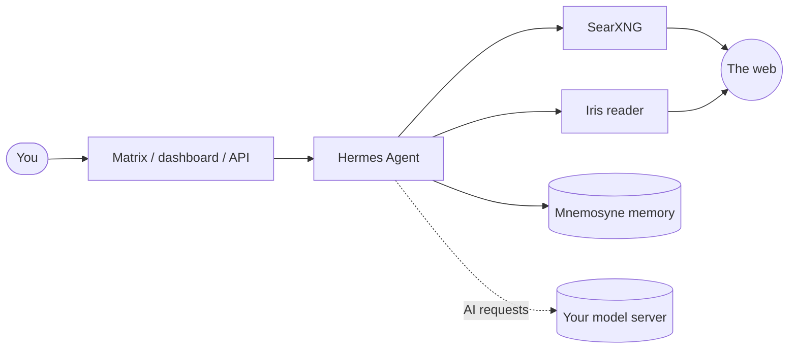

<p align="center">
  
</p>

# Caduceus

**A self-hosted personal AI agent that searches the web, reads what it finds and remembers what matters to you, on hardware you own.**

Caduceus combines three open-source projects, Obsidian's official sync client and one bundled plugin into one Docker Compose stack:

| Role | Project | What it does here |
|---|---|---|
| The brain | [Hermes Agent](https://github.com/NousResearch/hermes-agent) | Conversation, planning, tool use, scheduled jobs, chat gateways (Matrix and others), web dashboard, OpenAI-compatible API |
| Search | [SearXNG](https://github.com/searxng/searxng) | Private metasearch across many engines, with no tracking |
| Reading | Iris ([`plugins/iris`](plugins/iris)) | Fetches pages and turns them into clean text, rendering script-heavy pages in a headless browser |
| Memory | [Mnemosyne](https://github.com/mnemosyne-oss/mnemosyne) | Long-term memory of your preferences, projects and past conversations, stored locally in SQLite |
| Notes | [Obsidian Headless](https://obsidian.md/help/sync/headless) | Keeps the Obsidian vault the agent writes to in sync with your other devices |

The AI models are whatever OpenAI-compatible server you point it at: Ollama, LM Studio, vLLM, a GPU router such as NVIDIA PAIR, or a hosted API.

Upstream versions pinned as of October 24, 2026:

| Project | Version |
|---|---|
| Hermes Agent | [v0.22.5](https://github.com/NousResearch/hermes-agent/releases/tag/v0.22.5) |
| Mnemosyne | 0.7.3 ([d738487](https://github.com/mnemosyne-oss/mnemosyne/commit/d73848735a2a48471a62d2c8fb96cd7183c97491), Hermes plugin catalog pin) |
| Obsidian Headless | 0.0.14 (npm, pinned in `docker/obsidian-sync/Dockerfile`) |
| SearXNG | [2026.10.24-ef0ec03da](https://hub.docker.com/r/searxng/searxng/tags?name=2026.10.24-ef0ec03da) (container build) |

Mnemosyne is installed as a Hermes plugin from the plugin catalog, not cloned.
Iris is part of this repository. SearXNG
uses rolling dated builds. Source commits are pinned in `versions.env`; the
SearXNG image is pinned in `docker-compose.yml`.

The gateway and web dashboard run together in one `hermes` container, with
Hermes's built-in supervisor managing both processes. A one-shot `hermes-init`
service prepares their integration dependencies before startup.

## How it fits together



A request flows like this:
1. You send a message.
2. Hermes asks Mnemosyne what it already knows about you and the topic.
3. SearXNG finds sources, and Iris reads the best ones.
4. Your model writes a cited answer.
5. Mnemosyne stores anything new it learned.

Only web searches and page fetches leave your network, unless you point the model settings at a hosted API. The exception is a one-time download of Mnemosyne's embedding model from Hugging Face on the first start.

## Get started

See **[INSTALL.md](INSTALL.md)**. In short:

```bash
bin/setup                       # clone pinned upstreams, generate secrets, create .env
$EDITOR .env                    # point at your model server, pick models
docker compose build
docker compose up -d
bin/status
```

To run several independent instances on one machine, for example one per
person, see [Run more than one instance](INSTALL.md#10-run-more-than-one-instance-optional).

## What's in this repository

This repository holds only the orchestration. It does not include the upstream projects' code.

| Path | Purpose |
|---|---|
| `docker-compose.yml` | The services and automatic Hermes integration setup |
| `.env.example` | Every setting: models, ports, secrets, optional Matrix |
| `versions.env` | The exact upstream commits Caduceus is assembled against |
| `patches/` | Small fixes applied to upstream source by `bin/setup` |
| `config/` | Starter Hermes config and SearXNG settings |
| `bin/setup`, `bin/status` | Preparation and health checks |
| `bin/check-integrations`, `docker/hermes/` | Integration initialization and search, extraction, memory checks |
| `plugins/iris/` | Iris, the Hermes plugin that reads web pages for `web_extract` |
| `bin/cleanup` | Preview or reset Caduceus Docker resources; optionally erase Hermes host data |

`bin/setup` clones the upstream projects into `vendor/`, which is gitignored, and builds them from source.

For a fresh-install test, start with `bin/cleanup --dry-run --reset-data`.
See [reset instructions](INSTALL.md#reset-for-a-clean-install-test) for the
destructive reset and rebuild steps.

## License

Caduceus's own files are released under the [MIT License](LICENSE).

The upstream projects keep their own licenses: Hermes Agent and Mnemosyne are MIT, and SearXNG is AGPL-3.0. This repository only downloads and configures them, so their code is not covered by Caduceus's license. Note that the AGPL applies if you modify SearXNG and offer it as a network service to other people. In that case, you must make your modified source available to those users. Iris is part of Caduceus and covered by its MIT License.

The Caduceus name and logo are not covered by the MIT License. All rights are reserved.
